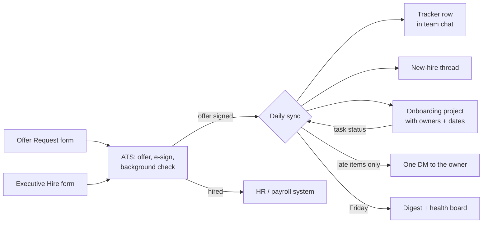

# Offer to Day One

**A hiring-to-onboarding operating system that gets every accepted offer to a ready, productive Day 1, without adding headcount to recruiting or People Ops.**

> The offer gets signed in one tool, the laptop gets ordered in another, and the new hire's first day depends on who remembered. This closes that gap.

**[Try the impact calculator →](https://brikonigin.github.io/offer-to-day-one/)** (runs in your browser on numbers you enter; nothing is sent anywhere) · [Source](index.html)

I built this while running recruiting at a company adding people faster than its processes could keep up. It connects the applicant tracking system (ATS), the project tool, the HR system and team chat so the handoff from "offer accepted" to "fully ready on Day 1" runs itself, with people stepping in only where judgment or privacy requires it. Every name, channel, ID and company detail has been removed or replaced with fictional examples.

---

## The problem

Most onboarding failures aren't caused by bad intentions. They happen in the handoffs.

When a team is hiring a few people a year, one person holds the whole process in their head. When hiring becomes a monthly or weekly event, that stops working:

- **The offer and the onboarding live in different tools.** Recruiting closes the candidate in the ATS. IT, payroll and the hiring manager find out by message, by email, or not at all.
- **Nobody owns the gap between "yes" and Day 1.** Laptops arrive late, accounts aren't ready, and the new hire spends their first week waiting instead of working.
- **Executives hire outside the process.** Leaders make fast, direct offers, and those hires skip every downstream step.
- **Status lives in people's heads.** Asking "is everyone ready for Monday?" means pinging four people.
- **More reminders make it worse.** Teams add alerts until everyone ignores them.
- **Candidate data spreads.** Names, pay and feedback end up in public channels and spreadsheets because there's no rule about where they belong.

Each of these is small. Together they cost weeks of productive time per hire, and they show up on the headcount plan as seats that are "filled" but not yet producing.

## Why the ATS alone doesn't solve this

This isn't a criticism of any one product. ATS platforms are built to manage candidates, and they do that well. The work after the offer belongs to other teams, in other tools.

| What a growing team needs | What the ATS typically covers |
|---|---|
| One record of every accepted offer, visible to IT, payroll and the manager | Offer status, visible to recruiting |
| A checklist with owners and due dates counted back from the start date | Candidate stages up to "Hired" |
| A heads-up only when something is late, only to the person who owns it | Notifications on every stage change |
| A safe place to talk about a new hire without exposing pay or personal data | Notes inside the candidate profile |
| A catch for hires that went around the process | Only what was entered in the ATS |

## What it does

| Stage | What happens | Who's involved |
|---|---|---|
| **1. Offer request** | Hiring manager submits a short form. Pay stays in the ATS and the approval thread, never in chat. | Hiring manager, recruiting |
| **2. Offer approval** | One named approver with a named backup chain. The approval is recorded in one place. | Executive approver |
| **3. Offer sent and signed** | The offer, e-signature and background check all run through the ATS integrations. | Recruiting |
| **4. Onboarding kickoff** | When the offer is signed, the automation opens a tracker row, posts a new-hire thread and creates the onboarding project with owners and due dates. | Automatic |
| **5. Pre-start** | Each owner (IT, payroll, hiring manager) works their own tasks. The tracker updates itself from the project tool. | Task owners |
| **6. Day 1** | A welcome email is drafted for a person to review and send. The hiring manager records whether Day 1 was fully ready. | Recruiting, hiring manager |
| **7. Weekly health** | A Friday digest and a health board show offers in flight, who starts soon, and what's blocking. | Everyone, read-only |

A separate **executive hire lane** lets leaders keep making fast, direct offers. A short intake form is the only thing they need to do, and the new hire still starts on time with everything ready.

## How it works

1. **The ATS is the record.** Every offer, including executive hires, ends up there. The sync reads it once a day.
2. **The project tool is the checklist.** Due dates are counted back in business days from the start date, so they move when the start date moves.
3. **Team chat is the conversation.** A tracker list and one thread per hire. No candidate data in the open hiring channel, ever.
4. **The automation runs on an AI agent skill** on a weekday schedule. It reads, compares, and writes only what changed. See [`skill/`](skill/offer-to-day-one-ops/SKILL.md).

The full process, with every step and owner, is in [docs/process.md](docs/process.md).

---

## Design principles

### Privacy by placement
- **Every piece of data has one home.** Pay lives in the ATS and the approval thread. The open hiring channel never sees candidate names, feedback or pay. The onboarding channel can use names, but never pay, IDs, bank details, addresses or background-check results.
- **The automation can't read what it doesn't need.** It never opens pay, ID numbers, bank details or check results, even when it has access.
- **Humans stay in the loop for anything sensitive.** The automation never changes a start date, moves a candidate stage, or contacts a candidate. It drafts; people send.

### Quiet by default
- **Only the person who must act gets a message.** Nobody is copied "for awareness."
- **No more than 3 automated messages per person per day,** and no more than one direct message.
- **It re-checks before every reminder.** It never nudges someone about work that's already done.
- **Shadow mode first.** New reminders run silently for a trial period so owners can confirm they're accurate before anyone receives one.

### Built for people who go around the process
- **Out-of-process hires are caught, not blamed.** A daily cross-check spots offers and projects that never touched the ATS and routes them privately to recruiting. The person who skipped the step is never named in a channel.
- **No duplicate work.** If someone already set things up by hand, the automation links to it instead of creating a second copy.

### Fail safe
- **If any connection fails, it does nothing** and sends one message to the process owner. Bad data never gets written.
- **It never overwrites what a person typed.** It fills blanks and its own columns only.

### Scales without headcount
- **The process is written once and the automation follows it.** The SOP and the skill are kept in step; if they ever disagree, the SOP wins and the automation stops.
- **It's cheap to run every day.** One query per tool, changed cells only, and a run where nothing changed writes nothing.

---

## Business impact

Recruiting operations is usually measured by time to fill. For a company with a headcount plan tied to revenue, the number that matters more is **time to productive**: from approved headcount to a person doing the job.

This system works on the back half of that timeline, from offer to Day 1 and the first week, where delays are usually invisible.

| Lever | What changes | Why it matters to the business |
|---|---|---|
| **Days from offer to start** | Fewer start dates pushed for missing paperwork, laptops or approvals | Every day a seat is empty is a day of planned output that doesn't happen |
| **Day-1 readiness** | New hires start with equipment, accounts and a plan | A lost first week is about 2% of a person's first year |
| **Offer acceptance** | Faster approvals and a clear handoff shorten the time a candidate waits | Slow offers lose candidates to faster competitors, and a lost offer restarts the search |
| **Operator hours** | Status chasing, tracker updates and digests are automated | Hours go back to sourcing and closing instead of coordination |
| **Plan accuracy** | Leadership sees who starts when and what's blocking | The headcount plan and the revenue plan stay in sync |

The [impact calculator](https://brikonigin.github.io/offer-to-day-one/) turns these into dollars and headcount for your own numbers. The formulas and assumptions are in [docs/impact-model.md](docs/impact-model.md).

**Results:** the system went live recently. I'll add measured before-and-after numbers (offer-to-start days, Day-1 readiness rate, weekly coordination hours) once there's enough data to report them honestly.

---

## What's in this repo

| Path | What it is |
|---|---|
| [`index.html`](index.html) | Single-file impact calculator (GitHub Pages) |
| [`docs/process.md`](docs/process.md) | The full offer-to-Day-1 process, step by step, with diagrams |
| [`docs/impact-model.md`](docs/impact-model.md) | How recruiting operations moves headcount, revenue and cost: formulas and assumptions |
| [`skill/offer-to-day-one-ops/`](skill/offer-to-day-one-ops/SKILL.md) | The AI agent skill that runs the daily sync, with every company detail replaced by placeholders |
| [`templates/`](templates/) | Offer Request and Executive Hire form fields, onboarding checklist, tracker fields, chat message templates |
| [`examples/`](examples/) | A sample Friday digest and health board on invented data |
| [`PRIVACY.md`](PRIVACY.md) | Where each kind of candidate and employee data may and may not go |

## Adapting it for your team

1. Map your tools to the three roles: **record** (your ATS), **checklist** (your project tool), **conversation** (your team chat).
2. Fill in [`templates/onboarding-checklist.md`](templates/onboarding-checklist.md) with your owners and business-day offsets from the start date.
3. Set up the tracker using [`templates/tracker-fields.md`](templates/tracker-fields.md). Keep the option lists short.
4. Replace the placeholders in [`skill/offer-to-day-one-ops/SKILL.md`](skill/offer-to-day-one-ops/SKILL.md) with your channel, list and project IDs.
5. Run it with reminders in **shadow** mode for two weeks. Turn them on once owners agree the flags are right.
6. Have your People or legal lead review [`PRIVACY.md`](PRIVACY.md) for your jurisdictions.

## Built with

Ashby (ATS, offers, e-signature and background check integrations) · Asana (onboarding projects) · Slack (lists, canvases, threads) · Rippling (HRIS and payroll) · Google Forms · Claude agent skills on a scheduled task. The approach works with any equivalent tools.

Related: [ai-hiring-toolkit](https://github.com/brikonigin/ai-hiring-toolkit) covers the front half of hiring (intake to interview to decision). [hiring-pulse](https://github.com/brikonigin/hiring-pulse) is the weekly pipeline dashboard. This repo picks up where they stop: the offer.

---

*All names, IDs and examples in this repo are fictional. Nothing here is legal advice; review employment, privacy and background-check rules for your jurisdictions before use.*
