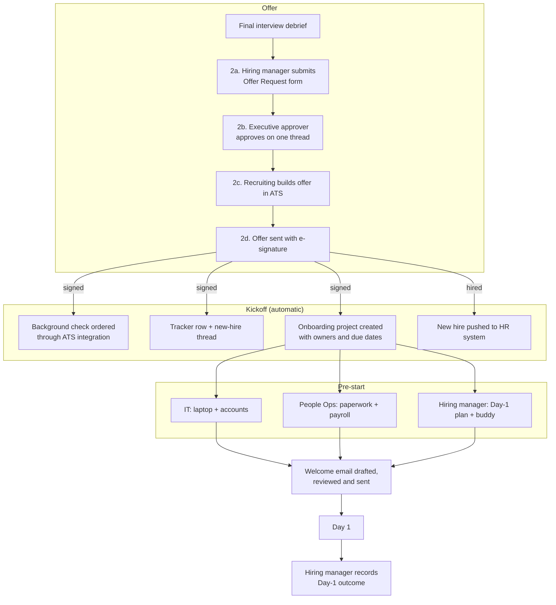

# The offer-to-Day-1 process

This is the anonymized version of the standard operating procedure (SOP) the automation follows. It's written for non-technical readers: hiring managers, IT, payroll and executives should be able to find their part in under a minute.

**Roles used throughout**

| Role | Owns |
|---|---|
| **Recruiting lead** | The process, the ATS, the automation, the welcome email |
| **People Ops** | Paperwork, payroll and benefits setup, background check follow-up |
| **IT** | Laptop, accounts and access |
| **Hiring manager** | Offer request, Day-1 plan and buddy, site access (on-site roles) |
| **Executive approver** | Offer approval (with a named backup chain) |
| **Automation** | Tracker, threads, project creation, late-item nudges, Friday digest |

---

## The whole flow

---

## Step 1. Decide

The interview team debriefs and the hiring manager makes the decision. Feedback stays in the ATS scorecards. Nothing about a specific candidate is posted in the open hiring channel.

## Step 2. Offer

**2a. Offer Request.** The hiring manager fills in a short form ([fields](../templates/offer-request-form.md)). It collects what everyone downstream needs: role, team, manager, start date, location, equipment, apps, and the compensation details for the approver. The form link is shared inside a channel template, not posted to the whole channel.

**2b. Approval.** One executive approves every offer on the Offer Request email thread. If they're out, the backup chain is named in advance. Approval is never a group decision in chat.

**2c–2d. Build and send.** Recruiting builds the offer in the ATS, sends it with integrated e-signature, and orders the background check through the ATS integration after signing.

### Executive hire lane

Leaders sometimes make offers directly, with short start dates. Instead of asking them to change how they work, they fill in a 2-minute [Executive Hire form](../templates/executive-hire-form.md). Recruiting backfills the ATS, and the rest of the process runs normally. If a hire never reaches the ATS, the daily cross-check flags it privately to recruiting.

## Step 3. Kickoff (automatic)

When the offer is signed, the automation:

1. Adds a row to the onboarding tracker (matched to the ATS by application ID, never by name).
2. Posts one new-hire thread in the onboarding channel with role, team, manager, start date and location.
3. Creates the onboarding project from the template, named `Onboarding: First Last (M/D)`, with owners and due dates set from the checklist.
4. Copies only the operational details from the Offer Request (role, equipment, apps, site needs) into the project. **Never pay, bonus, equity or relocation.**

Before creating a project, it searches for one made by hand. If it finds one, it links it instead of creating a duplicate.

## Step 4. Pre-start checklist

Due dates are counted in **business days** back from the start date, so they move automatically if the start date moves. Holidays follow a published bank-holiday calendar.

| Task | Owner | Due |
|---|---|---|
| Send onboarding note to new hire (Email 1) | People Ops | Offer signed, same day |
| Send manager kickoff (Email 2) | People Ops | Offer signed, same day |
| Confirm equipment spec and order laptop | IT | Offer signed, same day |
| Follow up on background and reference checks; right-to-work verification | People Ops | 1 business day after signing |
| Set up new hire in HR / payroll | People Ops | 5 business days before start |
| Confirm laptop delivered | IT | 3 business days before start |
| Pick a Day-1 buddy and post Day-1 details in the thread | Hiring manager | 2 business days before start |
| Provision accounts and access | IT | 1 business day before start |
| Request site access and badge (on-site roles) | Hiring manager | 1 business day before start |
| Review and send welcome email (Email 3) | Recruiting lead | Last business day before start |

**Start dates** default to Tuesdays, and never the day before or after a holiday weekend. That gives IT and People Ops a full business day of buffer.

## Step 5. Day 1 and Week 1

The hiring manager records one of four outcomes: *On time, fully ready* · *On time, items missing* · *Start date moved* · *No-show / rescinded*. This is the single most useful number the process produces: it's the share of new hires who could actually work on Day 1.

## Step 6. Weekly rhythm

| Day | What runs | Messages |
|---|---|---|
| Mon–Thu | Daily sync; late-item nudges | One DM per owner, only for late items |
| Wednesday | Hiring tracker refresh (pipeline counts per role, no names) | None |
| Friday | Health board update, onboarding digest, hiring roll-up | One digest per channel, only if something changed |

See a sample digest in [examples/friday-digest.md](../examples/friday-digest.md).

---

## Edge cases

| Situation | What the automation does | What it never does |
|---|---|---|
| Candidate declines | Marks the row closed and tells recruiting once in the digest | Post anything in the open hiring channel |
| Start date moves | Waits until People Ops changes it in the ATS, then refreshes | Change a date in any tool |
| Offer renegotiation | Pauses offer-related nudges while the blocker is set | Mention it in chat |
| Background check issue | Treats the item as handled; says only "start date on hold" | Write any detail anywhere |
| Executive hire outside the steps | Flags "not in ATS (executive hire?)" privately | Create records on its own |
| Contractor | Background check only; benefits items don't apply | |
| Contractor converts to employee | New row noted as a conversion | |
| Rehire | Matches by the new application ID | Create a second row for the same application |
| No-show | Closes the row once the hiring manager records it | |

## When the SOP and the automation disagree

The SOP wins. The automation stops and tells the recruiting lead. The SOP is versioned, and the skill notes which version it mirrors.
